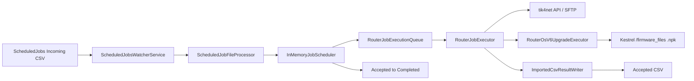

# Architecture

This document expands on the component boundaries of `MikrotikWorker`. The authoritative behaviour is always the source under `src/MikrotikWorker/`.

## Host composition / entry modes

`Program.cs` dispatches specialized CLI modes first, then builds the production web host when none match:

1. **Live package-compatibility audit** — `--audit-package-compatibility-live` **and** `LivePackageCompatibilityAudit:Enabled=true`. Read-only fleet inventory; no upgrade scheduler.
2. **Fixture package-compatibility audit** — `--audit-package-compatibility`. Non-live catalogue/fixture reporting only.
3. **OSPF-only lab recovery** — OSPF lab recovery runner flag (no firmware upgrade stages). Lab/gated; not the production CSV path.
4. **Production worker host** (`MikrotikWorkerHost`) — default path: Kestrel firmware HTTP, Serilog, CSV watcher, in-memory scheduler, router execution workers, upgrade services.

## Major components

| Area | Types | Responsibility |
|---|---|---|
| Hosting | `MikrotikWorkerHost`, `Worker`, listening options | DI, Kestrel binding, heartbeat |
| CSV ingestion | `ScheduledJobsWatcherService`, `ScheduledJobFileProcessor`, `ScheduledJobCsvParser` | Discover, validate, move, schedule |
| Scheduling | `InMemoryJobScheduler`, `RouterJobExecutionQueue` | Eligibility, capacity, dispatch, import accounting |
| Execution | `RouterJobExecutor`, `RouterJobExecutionService` | Connect, preflight, call upgrade path, complete jobs |
| Upgrade | `RouterOsV6UpgradeExecutor`, package resolvers, verifiers, `RouterboardFirmwareUpgradeService` | Two-stage RouterOS upgrade, OSPF, optional RouterBOARD upgrade |
| Firmware HTTP | Kestrel + static files under `/firmware_files` | Serve **`.npk` only** for `/tool/fetch` |
| Persistence | `ImportedCsvPathStore`, `ImportedCsvResultWriter` | Per-import Accepted CSV result columns |
| Logging | Serilog + `DeviceLogSink` | Application and per-device logs |

## State durability

All job and import tracking is **in memory only**. Process restart discards:

- Pending / dispatched / delayed-retry jobs
- Import batches and path-store registrations
- Held-for-dispatch lists

Filesystem artefacts that survive restart:

- `ScheduledJobs/{Processing,Accepted,Completed,Rejected}`
- `Backups/`
- `Logs/`
- `FirmwareFiles/`

There is **no** automatic resume or replay after restart. Operators re-import CSVs manually when appropriate.

## Concurrency model

Two independent limits:

1. **`ScheduledJobs:MaximumPendingJobs`** — scheduler admission / pending capacity (`SemaphoreSlim`).
2. **`ScheduledJobs:MaxConcurrentRouterJobs`** — execution workers (default and minimum 12).

CSV ingestion is additionally bounded by `MaxConcurrentCsvImports` and a discovery queue.

Future jobs never block eligible jobs. Occupied workers never block the scheduler loop.

## Related documents

- [CSV import](csv-import.md)
- [Scheduler](scheduler.md)
- [Retries](retries.md)
- [RouterOS upgrade](routeros-upgrade.md)
- [Firmware](firmware.md)
