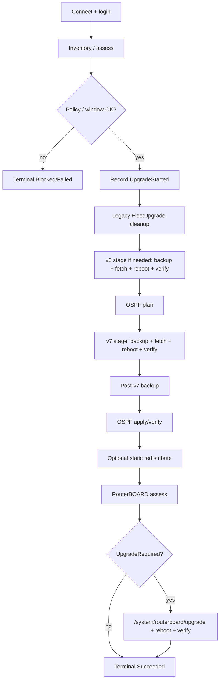

# RouterOS upgrade lifecycle

Primary executor: `RouterOsV6UpgradeExecutor`. Orchestration/preflight: `RouterJobExecutor`.

## Independent gates

| Gate | Effect when false |
|---|---|
| `Mikrotik:Enabled` | Jobs fail closed without opening API connections |
| `FirmwareUpgrade:Enabled` | Connect may occur for assessment paths, but upgrade is administratively disabled and jobs end **Failed** (never Succeeded) |

`FirmwareUpgrade:AdvertisedBaseUrl` must be a router-reachable HTTP base ending such that `/tool/fetch` can retrieve packages (documented in README as ending in `/firmware_files`). Empty advertised URL is rejected by validators when upgrades are enabled.

## High-level sequence (eligible device)

Exact ordering is implemented in `RouterOsV6UpgradeExecutor` (with branching for already-on-target, skip v6, etc.). The successful full path is approximately:

Exact branching for versions already on 6.49.23+, already on RouterOS 7, AlreadyUpToDate, etc. is implemented in the executor and covered in the root README tables.

## UpgradeStarted boundary

`UpgradeStarted` is persisted **after** connect, preflight, and policy gates succeed, and **before** mutation work (legacy cleanup / backup / fetch). Connection/authentication retries that never reach this boundary leave `UpgradeStarted` blank.

## Terminal outcomes

Scheduler terminal states map to CSV `Result` strings via `ImportedCsvResultColumns.FormatResult`. Only **Succeeded** and **AlreadyUpToDate** mean the device is on the configured RouterOS 7 target.

## Backup and OSPF

- Pre-upgrade backup is mandatory for upgrade stages that fetch/reboot.
- OSPF migration is fail-closed when required by the path.
- Optional `RedistributeSummaryviaStatics` runs after successful OSPF verification and before RouterBOARD assessment when enabled.
- Post-v7 backup precedes OSPF apply on the applicable path (not the reverse).

## RouterBOARD (RouterBOOT) firmware

After RouterOS package stages (and optional static redistribution), `RouterboardFirmwareUpgradeService`:

1. Assesses RouterBOOT via `RouterboardFirmwareAssessor` (`current-firmware` vs `upgrade-firmware`).
2. When **NotRequired** / conclusive success without upgrade, completes the RouterBOARD stage without issuing the API command.
3. When **UpgradeRequired**, calls `IMikrotikRouterOperations.UpgradeRouterboardAsync` → `MikrotikApiClient` issues **`/system/routerboard/upgrade`** (RouterBOOT loader only, not a RouterOS package install).
4. Reboots, then polls reconnect using **`FirmwareUpgrade:ReconnectInterval`** until **`FirmwareUpgrade:RebootTimeout`**, and verifies `current-firmware` advanced.

Compatibility assessment logging that mentions RouterBOOT versions does **not** itself issue `/system/routerboard/upgrade`; only this dedicated stage does when required.

## Related

- [Backup and OSPF](backup-and-ospf.md)
- [Firmware](firmware.md)
- [CSV import](csv-import.md)
