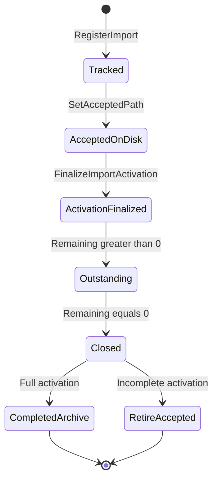

# Scheduler design

Primary type: `InMemoryJobScheduler` (`src/MikrotikWorker/Scheduling/InMemoryJobScheduler.cs`).

## Responsibilities

- Admit jobs with backpressure (`MaximumPendingJobs`)
- Hold jobs until Accepted path is registered (`HeldForDispatch` / `AcceptedOnDisk`)
- Wake on time (`TimeProvider`) for future eligibility and delayed retries
- Dispatch eligible jobs onto `RouterJobExecutionQueue`
- Track import batches (`ValidatedCount`, `ScheduledCount`, `Remaining`)
- Persist terminal CSV results then close imports (Completed archive or retire-leaving-Accepted)

## Job eligibility

- Inclusive start: `now >= DateStartUtc`
- Exclusive stop: `now >= DateStopUtc` ⇒ expired
- Window rechecked by workers immediately before connect

## Queues and capacity

| Structure | Role |
|---|---|
| Priority queue | Ordered by effective eligibility UTC + sequence |
| `_entries` | Pending / delayed (not yet handed to workers) |
| `_dispatched` | Handed to execution channel / in flight |
| `_capacity` | Semaphore for pending admission |
| Execution workers | Separate limit `MaxConcurrentRouterJobs` |

Duplicate `(ImportId, RowNumber)` schedules are ignored (capacity released).

## Fairness

Eligible jobs are selected without starving behind future work. Multiple imports share the same ready/dispatch machinery; isolation is by import identity and path store, not separate worker pools per CSV.

## Import closure

- **Full activation** (`ScheduledCount == ValidatedCount`, not incomplete): move Accepted → Completed; clear path store.
- **Incomplete activation**: leave CSV in Accepted; clear tracking and path store; do not Reject.

## Held-for-dispatch

If `ScheduleAsync` runs before `AcceptedOnDisk`, entries are stored on the batch and released only from `SetAcceptedPath` **after** the path store is updated. Production ingestion registers the path before scheduling; the hold is a correctness invariant.

## Related

- [CSV import](csv-import.md)
- [Retries](retries.md)
